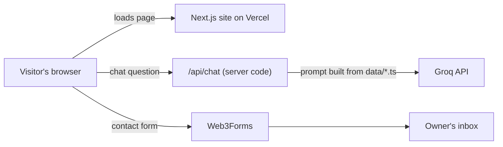

# 3D AI Engineer Portfolio

A high-graphics, scroll-driven portfolio website for an AI software engineer. It has an interactive 3D particle network, a glassmorphic sci-fi UI, an **AI chatbot that answers visitors' questions about the owner**, and a serverless contact form.

It was built step by step from absolute beginner level, and it is **100% free to build and host** (no credit card needed anywhere).

**Live demo:** https://sunil-portfolio-ten.vercel.app

Built by [Sunil Kumar Sah](https://github.com/sunilsah0).

<!-- Add a screenshot after you take one: save it as docs/screenshot.png and uncomment the next line -->

<!--  -->

---

## Table of contents

1. [Features](#features)
2. [Tech stack](#tech-stack)
3. [How it works](#how-it-works)
4. [Quick start (run it on your computer)](#quick-start-run-it-on-your-computer)
5. [Build it from scratch (beginner guide)](#build-it-from-scratch-beginner-guide)
6. [Make it yours](#make-it-yours)
7. [Environment variables](#environment-variables)
8. [Deploy for free (GitHub + Vercel)](#deploy-for-free-github--vercel)
9. [Updating the site later](#updating-the-site-later)
10. [Performance and accessibility](#performance-and-accessibility)
11. [Troubleshooting](#troubleshooting)
12. [Free-tier notes](#free-tier-notes)
13. [Project structure](#project-structure)

---

## Features

- **3D hero:** a glowing neural-network of nodes that drifts toward your mouse or finger. It pauses when off-screen, uses fewer nodes on phones, and respects the "reduce motion" setting.
- **Smooth scrolling** with Lenis and **scroll-reveal animations** with Framer Motion.
- **Floating glass Navbar** with a sliding active-section highlight and a mobile menu.
- **Skills matrix**, **project cards** with a mouse-following glow, and a **scroll-driven experience timeline**.
- **Contact form** with validation, a spam trap and no backend to maintain.
- **AI chatbot** that answers from the site's own data files, so it learns new projects automatically.
- **Easy to edit later:** all content lives in a few `data/` files. Edit, push to GitHub, and Vercel redeploys.
- Fully responsive (mobile, tablet, ultra-wide).

## Tech stack

| Purpose       | Tool                                                                         | Cost               |
| ------------- | ---------------------------------------------------------------------------- | ------------------ |
| Framework     | Next.js (App Router) + TypeScript                                            | Free               |
| Styling       | Tailwind CSS                                                                 | Free               |
| 3D graphics   | Three.js + React Three Fiber (`@react-three/fiber`, `@react-three/drei`) | Free               |
| Animation     | Framer Motion                                                                | Free               |
| Smooth scroll | Lenis                                                                        | Free               |
| Icons         | Lucide React (plus a few hand-made SVG brand icons)                          | Free               |
| Chatbot AI    | Groq API (Llama model)                                                       | Free tier, no card |
| Contact form  | Web3Forms                                                                    | Free tier, no card |
| Hosting       | Vercel (Hobby plan)                                                          | Free, personal use |
| Code hosting  | GitHub                                                                       | Free               |

## How it works



- The **page** is mostly static and fast.
- The **chatbot key stays on the server** (`/api/chat`), so visitors can never see it.
- The chatbot's knowledge is built automatically from `data/profile.ts`, `skills.ts`, `projects.ts`, `experience.ts` and `about.ts`.

---

## Quick start (run it on your computer)

Prerequisites: **Node.js LTS** (v20.9 or newer), **Git** and a code editor such as **VS Code**.

```bash
git clone https://github.com/sunilsah0/sunil-portfolio.git
cd sunil-portfolio
npm install
```

Create your settings file (see [Environment variables](#environment-variables) for the keys):

```bash
# macOS / Linux
cp .env.example .env.local

# Windows PowerShell
Copy-Item .env.example .env.local
```

Start the site:

```bash
npm run dev
```

Open **http://localhost:3000**. The site works without keys, but the chatbot and contact form need them.

---

## Build it from scratch (beginner guide)

This is exactly how the site was built, in 8 phases. Each phase was tested before moving to the next. The full code for every file is in this repository.

### Phase 1: Local setup

1. Install **Node.js (LTS)** from nodejs.org, **Git** from git-scm.com and **VS Code** from code.visualstudio.com.
2. Check the installs in a terminal:

```bash
node -v
npm -v
git --version
git config --global user.name "Your Name"
git config --global user.email "your-github-noreply-email"
```

> **Privacy tip:** on GitHub go to Settings → Emails, tick "Keep my email addresses private" and use the `...@users.noreply.github.com` address above, because Git commits on a public repo show the email.

3. Create the project. Run this from a normal folder such as your Desktop, **not from inside another project**:

```bash
npx create-next-app@latest sunil-portfolio
cd sunil-portfolio
```

Choose the recommended defaults (TypeScript, ESLint, Tailwind, App Router, import alias `@/*`). If asked about a `src/` directory, choose **No**.

4. Install the extra packages:

```bash
npm install framer-motion three @react-three/fiber @react-three/drei lucide-react lenis
npm install -D @types/three
```

5. Run it with `npm run dev` and open http://localhost:3000.
6. Create the extra folders: `components`, `components/three`, `data`, `lib`, `app/api/chat`.

### Phase 2: Theme, smooth scroll and Navbar

| File                            | What it does                                                                |
| ------------------------------- | --------------------------------------------------------------------------- |
| `data/profile.ts`             | Name, role, links and menu items in one place                               |
| `app/globals.css`             | Dark theme, glass effect, neon gradient text, custom scrollbar, Lenis rules |
| `components/SmoothScroll.tsx` | Lenis smooth scrolling (skipped if the user disabled motion)                |
| `components/Navbar.tsx`       | Floating glass Navbar with sliding highlight and mobile menu                |
| `app/layout.tsx`              | Fonts, metadata, and wraps the page in smooth scroll plus the Navbar        |
| `app/page.tsx`                | Stacks all sections                                                         |

### Phase 3: Interactive 3D hero

| File                                   | What it does                                                                 |
| -------------------------------------- | ---------------------------------------------------------------------------- |
| `components/three/ParticleField.tsx` | The 3D node network (lines between nodes are computed once, not every frame) |
| `components/Hero.tsx`                | Headline, badges, buttons and the animated terminal                          |

The 3D part is loaded with `dynamic(..., { ssr: false })` because Three.js needs a real browser screen.

### Phase 4: Skills matrix

| File                              | What it does                                                 |
| --------------------------------- | ------------------------------------------------------------ |
| `data/skills.ts`                | The skills, grouped by category (edit this to change skills) |
| `components/SectionHeading.tsx` | Reusable animated section title                              |
| `components/Skills.tsx`         | Staggered scroll-reveal grid of glass cards                  |

### Phase 5: Projects

| File                        | What it does                                                                       |
| --------------------------- | ---------------------------------------------------------------------------------- |
| `data/projects.ts`        | Your projects. A GitHub or Live Demo button only appears when you fill in its link |
| `components/icons.tsx`    | Hand-made brand icons (GitHub, LinkedIn, X), since Lucide removed brand logos      |
| `components/Projects.tsx` | Project cards with tags, result badges and a mouse-following glow                  |

### Phase 6: Experience, Contact and Footer

| File                           | What it does                                          |
| ------------------------------ | ----------------------------------------------------- |
| `data/experience.ts`         | Work and education timeline entries                   |
| `components/Experience.tsx`  | Scroll-driven timeline whose line fills as you scroll |
| `components/SocialLinks.tsx` | Social icons. Icons with empty links are hidden       |
| `components/Contact.tsx`     | Validated contact form that posts to Web3Forms        |
| `components/Footer.tsx`      | Footer with socials                                   |

Contact form setup: create a free access key at **web3forms.com** using the email where you want to receive messages, then put it in `.env.local` as `NEXT_PUBLIC_WEB3FORMS_KEY`.

### Phase 7: AI chatbot

| File                       | What it does                                                                            |
| -------------------------- | --------------------------------------------------------------------------------------- |
| `data/about.ts`          | Extra facts the bot may use (languages, certificates, availability)                     |
| `lib/botContext.ts`      | Builds the AI's instructions and facts from all `data/` files, including safety rules |
| `app/api/chat/route.ts`  | Server code: validates input, limits abuse, calls Groq, hides the key                   |
| `components/ChatBot.tsx` | Floating chat button and window                                                         |

Setup: create a free key at **console.groq.com** (API Keys) and put it in `.env.local` as `GROQ_API_KEY`. Do **not** prefix it with `NEXT_PUBLIC_`.

Safety built into the bot:

- It may only answer from the facts provided, and says "I don't know" otherwise.
- It refuses unrelated requests and ignores instructions inside visitor messages that try to change its rules.
- Messages are limited to 500 characters, history to the last 10 messages, and each visitor to about 10 messages per minute (a basic in-memory limit).
- Do not put private information (phone number, address) in the `data/` files, because the bot could repeat it.

### Phase 8: Deploy

See [Deploy for free](#deploy-for-free-github--vercel) below.

---

## Make it yours

If you want to use this as a template for your own portfolio, you only need to edit content files. You do not need to touch the components.

| What to change                                                                         | File                                                                            |
| -------------------------------------------------------------------------------------- | ------------------------------------------------------------------------------- |
| Name, role, GitHub and LinkedIn, hero text, terminal lines, badges, other social links | `data/profile.ts`                                                             |
| Skills                                                                                 | `data/skills.ts`                                                              |
| Projects (add or remove a block)                                                       | `data/projects.ts`                                                            |
| Work and education                                                                     | `data/experience.ts`                                                          |
| Extra facts the chatbot may use                                                        | `data/about.ts`                                                               |
| Page title and description                                                             | `app/layout.tsx`                                                              |
| Colors                                                                                 | `:root` section of `app/globals.css` (cyan `#22d3ee`, purple `#a855f7`) |
| Number of 3D nodes                                                                     | `ParticleField.tsx` (default 150 on desktop, 70 on mobile)                    |
| Images and your CV PDF                                                                 | `public/`                                                                     |

> Only list skills and results you can explain in an interview. Do not invent metrics.

---

## Environment variables

Create a file named `.env.local` in the project root (never commit it). A template is provided in `.env.example`.

| Name                          | Where it is used       | Required        | Notes                                                                                                 |
| ----------------------------- | ---------------------- | --------------- | ----------------------------------------------------------------------------------------------------- |
| `GROQ_API_KEY`              | Server only (chatbot)  | For the chatbot | Secret. From console.groq.com                                                                         |
| `GROQ_MODEL`                | Server only (chatbot)  | No              | Defaults to `llama-3.3-70b-versatile`. Change if Groq retires it (see console.groq.com/docs/models) |
| `NEXT_PUBLIC_WEB3FORMS_KEY` | Browser (contact form) | For the form    | Public by design: it can only send messages to your inbox                                             |

Rules to remember:

- After editing `.env.local`, **restart** `npm run dev`.
- On Vercel, paste **only the value**: no quotes, no spaces, no `NAME=` in front.
- On Vercel, after adding or changing a variable, **redeploy**. `NEXT_PUBLIC_` values are baked into the site at build time.

---

## Deploy for free (GitHub + Vercel)

### 1. Check locally first

```bash
npm run build
npm audit --omit=dev
git check-ignore -v .env.local   # must print a .gitignore line
```

Never run `npm audit fix --force`, because it can break the project.

### 2. Put the code on GitHub

Create an **empty** public repository on github.com (do not add a README, `.gitignore` or license in the website form). Then:

```bash
git add .
git status          # make sure .env.local and node_modules are NOT listed
git commit -m "Initial portfolio website"
git branch -M main
git remote add origin https://github.com/YOUR-USERNAME/YOUR-REPO.git
git push -u origin main
```

### 3. Deploy on Vercel

1. Go to vercel.com and sign up with GitHub on the **Hobby** plan.
2. **Add New → Project**, import your repository, and keep the Next.js defaults.
3. Add the environment variables from the table above.
4. Click **Deploy**. In a minute or two you get a free `https://your-project.vercel.app` address.

### 4. Test the live site

Check the 3D scene, smooth scrolling, a chatbot question and a real contact-form message, ideally on your phone too.

### Optional: a nicer address

- Rename the project in Vercel (Settings → Domains) to get a shorter `.vercel.app` address.
- Free subdomains such as `yourname.is-a.dev` are available through the is-a.dev project (follow the guide at docs.is-a.dev yourself). A `.com` costs a yearly fee.

---

## Updating the site later

1. Edit a file in `data/` (for example, add a project to `data/projects.ts`).
2. Check it with `npm run dev`.
3. Publish it:

```bash
git add .
git commit -m "Add new project"
git push
```

Vercel detects the push and redeploys in about a minute. If something breaks, roll back from the **Deployments** tab on Vercel.

---

## Performance and accessibility

- The device pixel ratio of the 3D canvas is capped, antialiasing is off and the GPU preference is "low power".
- Node connections are computed once in `useMemo`, not on every frame, and the random layout is seeded so it looks the same on every load.
- Rendering pauses when the hero scrolls out of view.
- Fewer nodes on phones, and no spinning if "reduce motion" is enabled (this also disables smooth scroll and shortens CSS transitions).
- Scroll animations run once (`viewport={{ once: true }}`).
- Form fields have labels, errors use readable text, and status messages use `aria-live`.

---

## Troubleshooting

| Problem                                                                                   | Cause and fix                                                                                                                                                                                                                                           |
| ----------------------------------------------------------------------------------------- | ------------------------------------------------------------------------------------------------------------------------------------------------------------------------------------------------------------------------------------------------------- |
| The project is in a folder inside a folder, and Next.js warns about `package-lock.json` | `create-next-app` was run inside an existing folder. Delete the stray `node_modules`, `package.json` and `package-lock.json` in the outer folder and work only in the inner one. Next time, run `create-next-app` from the parent folder      |
| "Blocked cross-origin request to /_next/hmr" and WebSocket errors in the console          | You opened the Network address (for example `192.168.x.x:3000`). Use `localhost:3000`, or add `allowedDevOrigins: ["192.168.x.x"]` inside the object in `next.config.ts` and restart                                                            |
| "An Application Control policy has blocked this file" (Windows)                           | Windows blocked Next.js's native compiler, so it falls back to a slower one. The site still runs and Vercel builds on its own servers, so this is safe to ignore                                                                                        |
| "peer dependency" errors during `npm install`                                           | Paste the full error. It usually means a library version mismatch with React                                                                                                                                                                            |
| `THREE.Clock: This module has been deprecated` in the console                           | A harmless warning from the 3D library. Ignore it                                                                                                                                                                                                       |
| `chext_loader.js` or "Initialized driver" messages                                      | They come from a browser extension, not this site                                                                                                                                                                                                       |
| Chat says "The chatbot is not set up yet"                                                 | `GROQ_API_KEY` is missing, misspelled, or the server was not restarted or redeployed                                                                                                                                                                  |
| Chat returns 502 or "assistant is unavailable"                                            | Groq rejected the request. Read the line starting with `Groq error` in your terminal, or in Vercel's runtime logs. Usual causes: quotes or spaces in the key on Vercel, a variable added without redeploying, or a retired model (set `GROQ_MODEL`) |
| Mouse wheel scrolls the page instead of the chat                                          | The chat messages box needs the `data-lenis-prevent` attribute (already included in `ChatBot.tsx`)                                                                                                                                                  |
| Contact form says it is not set up                                                        | `NEXT_PUBLIC_WEB3FORMS_KEY` is missing. Add it, then restart locally or redeploy on Vercel                                                                                                                                                            |
| Build error mentioning `new Date()` or uncached data                                    | This project uses Next.js Cache Components. Avoid reading the current time during rendering. The footer sets the year inside `useEffect` for this reason                                                                                              |
| Brand icons missing from Lucide (for example GitHub)                                      | Newer Lucide versions removed brand logos. Use the SVGs in `components/icons.tsx`                                                                                                                                                                     |

---

## Free-tier notes

These were true in October 2026. Check each provider's pricing page before relying on them.

- **Vercel Hobby:** free, no credit card, for personal and non-commercial use only.
- **Web3Forms free plan:** about 250 submissions per month, with 30 days of stored history.
- **Groq free tier:** no credit card, limited by rate limits. If the limit is reached, the chatbot pauses instead of charging you. Model names change over time.
- **GitHub:** free for public repositories.

---

## Project structure

```
.
├── app/
│   ├── api/chat/route.ts     # chatbot server code (hides the API key)
│   ├── globals.css           # theme, glass effect, scrollbar
│   ├── layout.tsx            # fonts, metadata, smooth scroll, Navbar
│   └── page.tsx              # assembles all sections
├── components/
│   ├── three/ParticleField.tsx   # 3D network
│   ├── ChatBot.tsx
│   ├── Contact.tsx
│   ├── Experience.tsx
│   ├── Footer.tsx
│   ├── Hero.tsx
│   ├── Navbar.tsx
│   ├── Projects.tsx
│   ├── SectionHeading.tsx
│   ├── Skills.tsx
│   ├── SmoothScroll.tsx
│   ├── SocialLinks.tsx
│   └── icons.tsx
├── data/                     # ALL your content lives here
│   ├── about.ts
│   ├── experience.ts
│   ├── profile.ts
│   ├── projects.ts
│   └── skills.ts
├── lib/botContext.ts         # builds the chatbot's instructions from data/
├── public/                   # images, CV PDF, favicon
├── .env.example              # template for your keys (safe to commit)
└── .env.local                # your real keys (never commit)
```
